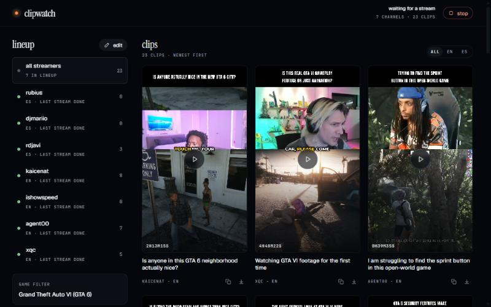
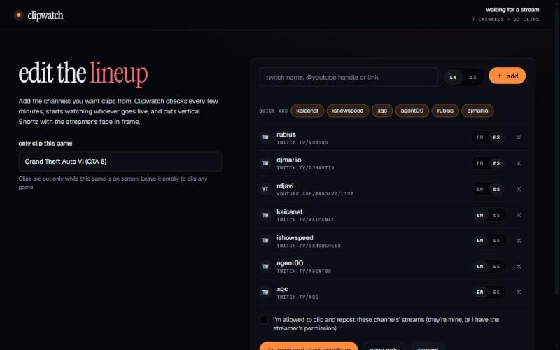

# clipwatch

Watches streamers while they're live and cuts vertical Shorts with their face in frame. Free to run.



## Start with your agent

Paste this into Claude Code, Codex, Cursor or any agent that can run commands on your PC:

```text
Set up Clipwatch for me: https://github.com/gabriel-pauta/clipwatch
1. Clone it. Check I have Python 3.11, ffmpeg and git; if not, give me the winget command.
2. Ask me which streamers I want (Twitch name, YouTube @handle or Kick link) and if each
   one's clips are English or Spanish. Ask which game to clip (default GTA 6, empty = any).
3. Save that to app/lineup.json like this:
   {"game": "Grand Theft Auto VI (GTA 6)", "en": ["https://www.twitch.tv/name"], "es": []}
4. Run start.bat. First run installs ~2 GB, so it takes a while.
5. When http://localhost:8000/console opens, tell me to add my Google API key there
   and press "start watching" myself.
```

## Start by hand

1. Install [Python 3.11](https://www.python.org/downloads/release/python-3119/), ffmpeg (`winget install Gyan.FFmpeg`) and git.
2. Run:

```powershell
git clone https://github.com/gabriel-pauta/clipwatch
```

```powershell
.\clipwatch\start.bat
```

3. The console opens at **http://localhost:8000/console**. Pick your streamers, add your free Google API key ([get one here](https://aistudio.google.com/apikey)), press **start watching**.



## How it works

- Every 5 minutes it checks who's live and starts watching them.
- It only clips while your game is on screen, and only when the streamer's face is visible.
- Clips show up in the console and in `app/clips-en/` or `app/clips-es/`. Each one has a `.txt` with a title and ready-to-paste captions.

## Rules

Only clip streams you're allowed to: your own, or a streamer who said yes.

## Folders

| Folder | What's in it |
|---|---|
| `app/` | the program |
| `app/console/` | the web page |
| `images/` | screenshots for this page |

Built on [OpenShorts](https://github.com/mutonby/openshorts). MIT license.
